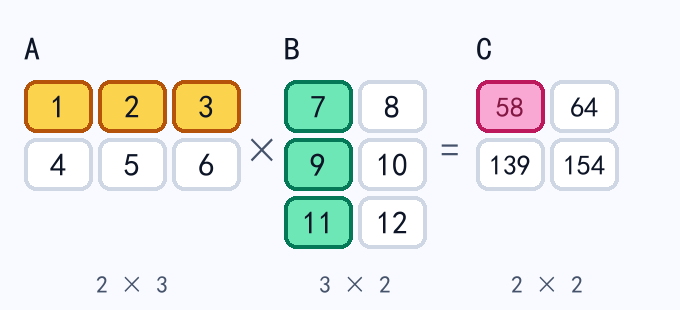
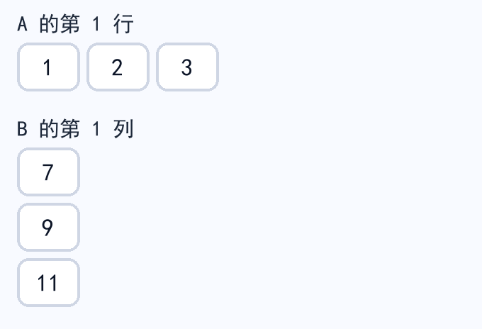
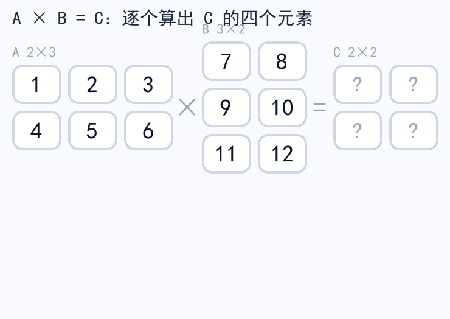
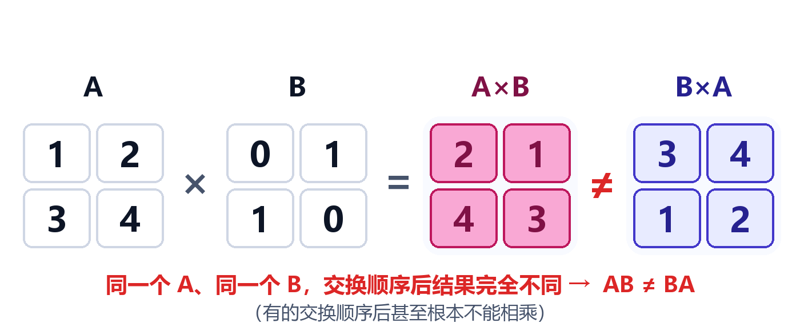
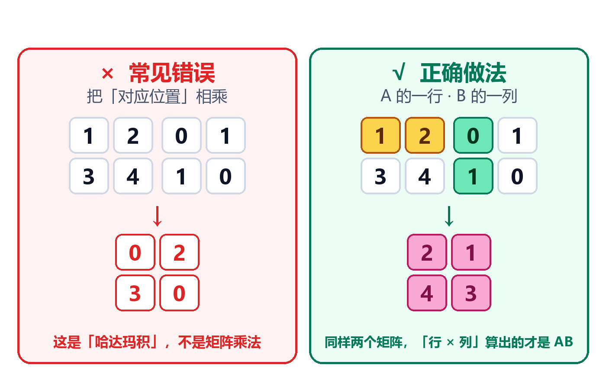

> 初学矩阵乘法最容易踩的坑，就是把它当成「对应位置相乘」。其实规则只有一条：**左边取一行，右边取一列，配对相乘再相加**。

## 一句话本质：行点乘列

结果矩阵 C 的第 i 行第 j 列，等于 A 的第 i 行与 B 的第 j 列**对应元素相乘后再求和**：

$$C_{i,j}=\sum_{k=1}^{K}A_{i,k}\times B_{k,j}$$

算出一个元素，需要 **K 次乘法**和 **K−1 次加法**。

---

## 为什么非要这样算？

这不是数学家凭空规定的。回到最熟悉的二元一次方程组：

$$
\begin{cases}
x+2y=5\\
3x+4y=6
\end{cases}
$$

把系数、未知数、常数各自排成方块，就能把它缩写成一行：

$$
\begin{pmatrix}1&2\\3&4\end{pmatrix}
\begin{pmatrix}x\\y\end{pmatrix}
=
\begin{pmatrix}5\\6\end{pmatrix}
$$

要让这个缩写成立，左边的乘法**只能**是「行 × 列」：

- 第 1 行 $[1,2]$ · 第 1 列 $[x,y]$ → $1x+2y$，正好是第 1 个方程的左端；
- 第 2 行 $[3,4]$ · 第 1 列 $[x,y]$ → $3x+4y$，正好是第 2 个方程的左端。

---

## 矩阵乘法的结构

### 先看清谁和谁配对

黄色是 A 的第 1 行，绿色是 B 的第 1 列——它们相遇的位置，就是粉色格 C₁₁：

---

### C₁₁ 的三个乘积

A 的第 1 行 `[1, 2, 3]` 与 B 的第 1 列 `[7, 9, 11]` 逐一配对相乘，再累加：

$$C_{1,1}=1\times7+2\times9+3\times11=7+18+33=58$$

---

### 剩下三个元素

C₁₁ 算完后，其余三个元素只是**换了一对「行与列」**，流程完全一样：

---

#### 完整手算一遍

| 元素 | 算式                             | 结果    |
| ---- | -------------------------------- | ------- |
| C₁₁  | 1×7 + 2×9 + 3×11 = 7 + 18 + 33   | **58**  |
| C₁₂  | 1×8 + 2×10 + 3×12 = 8 + 20 + 36  | **64**  |
| C₂₁  | 4×7 + 5×9 + 6×11 = 28 + 45 + 66  | **139** |
| C₂₂  | 4×8 + 5×10 + 6×12 = 32 + 50 + 72 | **154** |

合起来就是：

$$
\begin{pmatrix}1&2&3\\4&5&6\end{pmatrix}
\begin{pmatrix}7&8\\9&10\\11&12\end{pmatrix}
=
\begin{pmatrix}58&64\\139&154\end{pmatrix}
$$

**要点归纳**：① **配对**——左矩阵的**列数**等于右矩阵的**行数**（都是 K），元素才能一一对应；② **相乘**——每一对算一个乘积；③ **求和**——把 K 个乘积加总，就是结果元素的值。

---

### 什么时候能乘？——维度规则

能相乘的前提只有一条：左矩阵的**列数**等于右矩阵的**行数**。结果的形状由两侧「外围」维度决定：

- ✅ 能乘：`(m × k) × (k × n) = (m × n)` —— 中间的 **k 必须相等**
- ❌ 不能乘：`(m × 3) × (4 × n)` —— **3 ≠ 4**，配对配不齐，乘法没有定义

就像拼积木，中间的接口必须对得上。

**3 秒判断法**：把两个维度写成 `(m×k) (k×n)`，先划掉中间两个**相同**的数，剩下的 `m×n` 就是结果的形状；若中间两个数不同，直接写「不能相乘」。

### 四条必须记住的性质

| 性质           | 内容                                                                                          |
| -------------- | --------------------------------------------------------------------------------------------- |
| × 不满足交换律 | 一般来说 **AB ≠ BA**。甚至 AB 有意义时，BA 可能根本无法相乘——这是矩阵乘法与普通乘法最大的区别 |
| √ 满足结合律   | **(AB)C = A(BC)**，可以放心写 ABC，计算顺序可自选——也是矩阵计算加速优化的理论基础             |
| √ 满足分配律   | **A(B + C) = AB + AC**，**(A + B)C = AC + BC**，对矩阵加法可分配                              |
| √ 单位矩阵     | **I**（主对角线为 1，其余为 0）满足 **AE = EA = A**，相当于乘法中的「1」                      |

顺序真的不能换，看同一个 A、同一个 B：

顺手再记两条：

- **零矩阵**：O 乘任何同尺寸的矩阵都是 O；
- **转置法则**：$(AB)^{\mathrm{T}}=B^{\mathrm{T}}A^{\mathrm{T}}$ —— 顺序要**倒过来**（和「不能交换顺序」是同一个道理）。

---

### 三个最常见的错误

**错误 1：把「对应位置」相乘。**

这是**哈达玛积**（逐元素相乘），不是矩阵乘法。下面一张图看清差别：

**错误 2：把结果的行列写反。**

结果的行数来自**左边**矩阵、列数来自**右边**矩阵。`(2×3) × (3×2)` 得到的是 `2×2`，不是 `3×3`。

**错误 3：以为 AB = BA。**

上面的图已经说明：交换顺序结果完全不同，甚至还可能根本不能相乘。

### 动手检验

**第 1 题：下面哪几个能相乘？**

- ① A 是 3×2，B 是 2×5
- ② A 是 3×2，B 是 3×5
- ③ A 是 2×2，B 是 2×2

**第 2 题：算出来**

$$
\begin{pmatrix}2&1\\0&3\end{pmatrix}
\begin{pmatrix}1&4\\2&0\end{pmatrix}
=\ ?
$$

**第 3 题：验证 AB ≠ BA**

取 $A=\begin{pmatrix}1&2\\3&4\end{pmatrix}$、$B=\begin{pmatrix}0&1\\1&0\end{pmatrix}$，分别算出 AB 与 BA，看是否相等。

**想好了再往下划 ——**

### 答案

**第 1 题**：① 能（2 = 2，结果为 3×5）；② **不能**（2 ≠ 3，中间对不上）；③ 能（结果为 2×2）。

**第 2 题**：

$$
\begin{pmatrix}2&1\\0&3\end{pmatrix}
\begin{pmatrix}1&4\\2&0\end{pmatrix}
=
\begin{pmatrix}4&8\\6&0\end{pmatrix}
$$

（例如左上角那一格：$2\times1+1\times2=4$；右上角：$2\times4+1\times0=8$。）

**第 3 题**：

$$
AB=\begin{pmatrix}2&1\\4&3\end{pmatrix},
\qquad
BA=\begin{pmatrix}3&4\\1&2\end{pmatrix}
$$

两者不同，所以 **AB ≠ BA**。

---

## 一句话记住

> 矩阵乘法 = 把左边矩阵的**每一行**，依次与右边矩阵的**每一列**做「**配对 → 相乘 → 求和**」。
> 中间维度（K）必须对得上，结果的形状取两端（m × n）。

---
